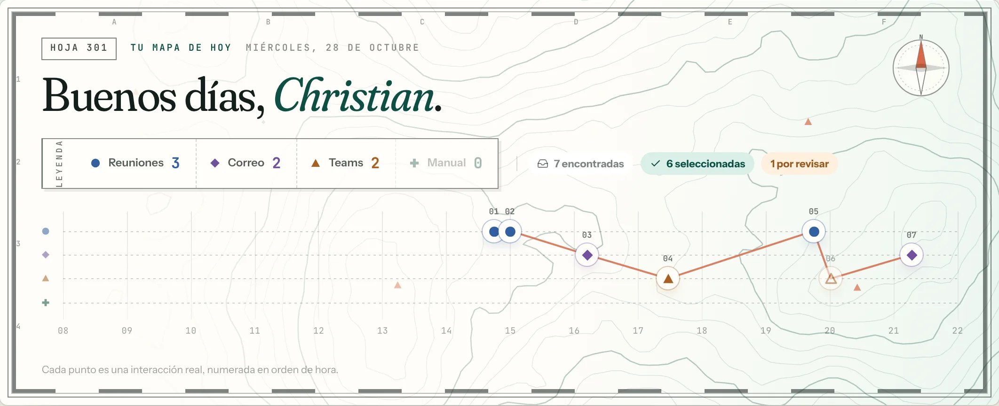
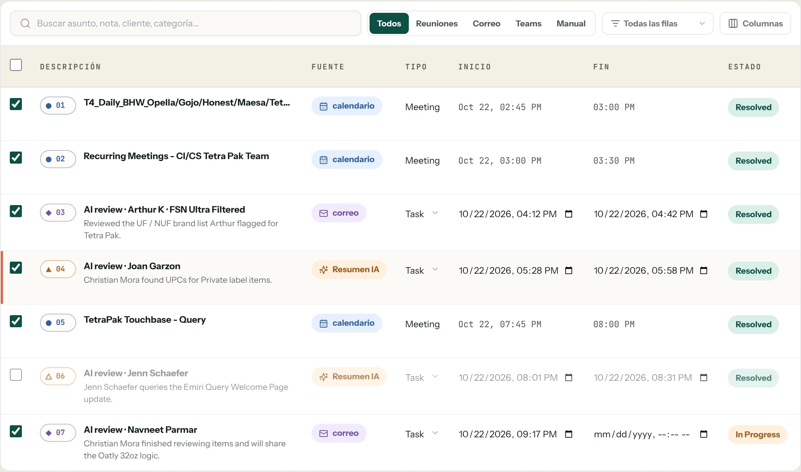
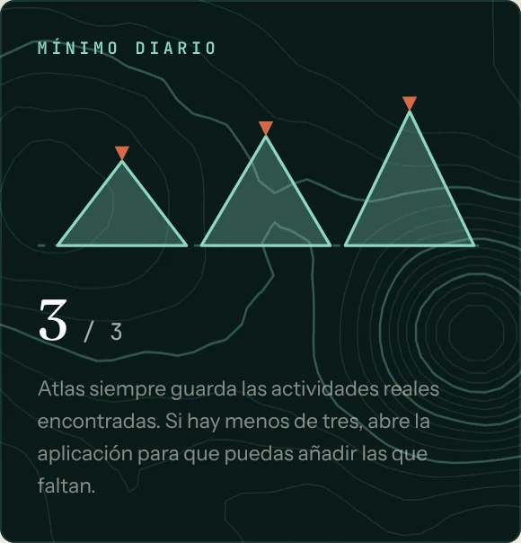
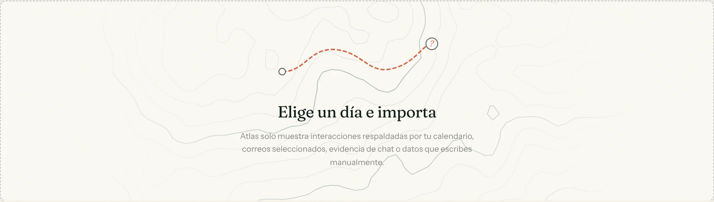
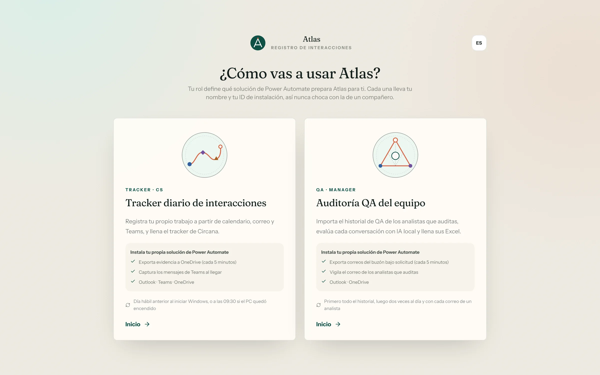

<p align="center">
  
</p>

<p align="center">
  <a href="https://github.com/ChristianMoraLopez/Atlas/releases/latest"></a>
  <a href="https://github.com/ChristianMoraLopez/Atlas/actions/workflows/ci.yml"></a>
  
  
</p>

<p align="center">
  <a href="#-qué-hace-atlas">Qué hace</a> ·
  <a href="#-de-la-evidencia-al-tracker">Cómo funciona</a> ·
  <a href="#-la-hoja-del-día">La interfaz</a> ·
  <a href="#-instalar">Instalar</a> ·
  <a href="#-identidad-visual">Identidad visual</a> ·
  <a href="#-desarrollo">Desarrollo</a>
</p>

---

**Atlas** es una aplicación de escritorio para Windows que convierte tu calendario,
tu correo y tus chats de Teams en las filas del **tracker de interacciones de
Circana**. Lee la evidencia que Power Automate deja en tu OneDrive, la interpreta
con una IA que corre en tu propio equipo y te muestra el día como un mapa: cada
reunión o tarea es un punto numerado en una ruta. Revisas, ajustas y exportas al
Excel con un clic, sin tocar macros ni fórmulas.

> **Atlas no inventa actividad.** Cada fila exportada es una reunión que ocurrió,
> una tarea concreta respaldada por un correo o un chat real, o algo que escribiste tú.
> Las conversaciones personales, los avisos automáticos y los hilos donde no participas
> se quedan fuera.

<br />

## 🧭 Qué hace Atlas

| | |
| --- | --- |
| **Reuniones** | Toma las reuniones terminadas del calendario, sin duplicar las reenviadas, actualizadas o canceladas. |
| **Correo** | La IA local separa el trabajo real del ruido de la bandeja: recordatorios, boletines y notificaciones no entran. |
| **Teams** | Agrupa los chats por conversación y descarta lo personal antes y después de la IA: cada tarea debe hablar de trabajo y tú debes estar en ella. |
| **Varios días** | Importa un rango completo (hasta 31 días hábiles) y te entrega un informe por día con lo que falta para el mínimo de 3. |
| **Bitácora editable** | Búsqueda, filtros por fuente y estado, columnas ocultables y una descripción breve en cada fila para decidir rápido. |
| **Excel seguro** | Escribe en `.xlsx` o `.xlsm` sin romper macros, fórmulas ni otras hojas. Si el archivo está abierto, te avisa y guarda en cuanto lo cierras. |
| **Automático** | Al iniciar Windows registra el día hábil anterior; si el PC no se reinició, lo hace a las 09:30. |
| **Privado** | La IA (Ollama + Qwen2.5) viene dentro del instalador y corre solo en tu equipo. Nada sale a un servicio externo. |

<br />

## 🔄 De la evidencia al tracker

```mermaid
flowchart LR
    PA["Power Automate<br/>calendario · correo · Teams"] -->|JSON en OneDrive| IN["Bandeja AtlasBridge"]
    IN --> RD["Atlas lee el día<br/>reuniones sin repetidos"]
    RD --> FL["Filtro de trabajo<br/>fuera chats personales"]
    FL --> AI["IA local<br/>Qwen2.5 en tu CPU"]
    AI --> VA["Validación<br/>evidencia real y tu participación"]
    VA --> LB["Bitácora<br/>revisas y ajustas"]
    LB --> XL["Tracker de Excel<br/>sin duplicados"]

    classDef paper fill:#fffdf8,stroke:#121e1c,stroke-width:1px,color:#121e1c
    classDef route fill:#f8e2d6,stroke:#d66848,stroke-width:1.5px,color:#121e1c
    classDef ink fill:#0f4f45,stroke:#0f4f45,color:#ffffff
    class PA,IN,RD,LB paper
    class FL,AI,VA route
    class XL ink
```



1. **Power Automate exporta tu día.** Una solución personalizada con tu nombre deja
   cada 5 minutos un paquete de evidencia en `OneDrive/AtlasBridge/inbox` y captura
   los mensajes de Teams a medida que llegan.
2. **Atlas lee solo el día pedido.** Ignora los paquetes de otras fechas y une las
   copias de una misma reunión (reenviadas, actualizadas o canceladas).
3. **Filtra antes de gastar IA.** Los chats que nunca mencionan trabajo no se envían
   al modelo, así cada lote tarda menos y lo personal no llega al tracker.
4. **La IA propone tareas.** Un resumen corto en inglés por tarea, con referencia a
   los mensajes exactos que la respaldan. Mientras trabaja, Atlas te dice qué está
   leyendo y en qué lote va.
5. **Se valida cada sugerencia.** Se descartan las que copian una línea del chat
   en vez de describir trabajo, los avisos y las preguntas de canales donde no
   participas. Las interpretaciones quedan en caché: re-importar un día es inmediato.
6. **Tú decides.** La bitácora muestra todo con su punto en la ruta; seleccionas,
   corriges o añades una tarea manual.
7. **Se escribe el tracker.** Una columna oculta `_source_id` hace que repetir la
   exportación actualice las mismas filas en lugar de duplicarlas.

<br />

## 🗺️ La hoja del día

Atlas no es un tablero más: cada día es una **hoja de levantamiento topográfico**.

<p align="center">
  
</p>

- **Tu terreno.** Las curvas de nivel se generan a partir de tu nombre: siempre es
  el mismo mapa para ti, distinto al de cualquier compañero.
- **La ruta.** Un carril por fuente y un punto por interacción, numerado en orden
  de hora. La línea terracota se dibuja sola al abrir el día.
- **Formas, no solo colores.** Reunión ●, correo ◆, Teams ▲, manual ✚.
  Se distinguen aunque no se vea bien el color.
- **Hoja y leyenda.** El número de hoja es el día del año; la leyenda cuenta cuántas
  interacciones trajo cada fuente.

### La bitácora

<p align="center">
  
</p>

Cada fila lleva el mismo número y símbolo que su punto en el mapa. Al pasar el cursor
por una fila se ilumina su punto, y al hacer clic en un punto la tabla salta a su
fila. Lo que ocultas o filtras aquí solo cambia la vista: **el Excel siempre recibe
el formato completo.**

<table>
  <tr>
    <td width="34%" valign="top">
      
    </td>
    <td valign="top">
      <h3>Tres cumbres</h3>
      <p>El mínimo diario de tres actividades se ve como tres picos que se iluminan con
      cada fila seleccionada. Si el día queda corto, Atlas abre la ventana para que
      añadas lo que falta; nunca rellena por ti.</p>
      <h3>Tinta del mapa</h3>
      <p>Pino, terracota, índigo o grafito: el color que elijas recolorea toda la
      aplicación y se recuerda en tu equipo.</p>
      <h3>Hoja en blanco</h3>
      <p>Un día sin importar se muestra como una hoja sin explorar, con la ruta
      punteada esperando su primer punto.</p>
    </td>
  </tr>
</table>

<p align="center">
  
</p>

<br />

## 👥 Dos roles, una solución por persona

<p align="center">
  
</p>

La configuración empieza eligiendo un rol. Cada uno instala **su propia** solución de
Power Automate, personalizada con tu nombre y el ID de tu instalación, para que
nunca choque con la de un compañero en el mismo entorno:

| Rol | Solución | Flujos | Conectores |
| --- | --- | --- | --- |
| **Tracker · CS** | `AtlasBridge` | Exportar evidencia a OneDrive (cada 5 min) · Capturar mensajes de Teams | Outlook, Teams, OneDrive |
| **QA · Manager** | `AtlasQA` ([detalles](power-automate-qa/README.md)) | Exportar el buzón bajo solicitud · Vigilar el correo de los analistas | Outlook, OneDrive |
| Tracker, opcional | `AtlasTrackerWriter` | Escribir el tracker diario en SharePoint | OneDrive, SharePoint, Excel |

El asistente de conectores abre el portal oficial de Power Automate, personaliza el
paquete (por ejemplo *Atlas QA - Christian Mora - a84c12f9*) y una versión nueva de
Atlas actualiza la misma solución en lugar de crear otra.

**Rutina del tracker.** Atlas arranca oculto al iniciar sesión en Windows, registra
el día hábil anterior y se queda en el área de notificaciones. Si una ejecución
falla, la reintenta a los 45 minutos, hasta cuatro veces.

**Rutina de QA.** Importa el historial completo de los analistas por meses, luego
sincroniza a las 09:00, a las 15:00 y cada vez que un analista escribe. Evalúa cada
conversación con la IA local y llena un libro por analista; los casos ya revisados
nunca se sobrescriben.

<br />

## 📥 Instalar

1. Descarga `Atlas_<versión>_Windows_x64_Setup.exe` de la
   [última versión](https://github.com/ChristianMoraLopez/Atlas/releases/latest).
2. Ejecútalo. Se instala solo para tu usuario, **sin permisos de administrador**, y
   aparece en el menú Inicio.
3. Para actualizar, ejecuta el instalador nuevo encima del anterior: tu
   configuración, tu tracker y lo ya interpretado se conservan.

El instalador incluye Ollama (solo CPU) y el modelo `qwen2.5:1.5b-instruct-q4_K_M`;
no hay que instalar nada más. Si vienes de la versión portable, borra esa carpeta
después de instalar. Más detalles en [`docs/INSTALL.md`](docs/INSTALL.md).

> Las compilaciones internas no están firmadas y Windows SmartScreen puede pedir
> confirmación la primera vez.

### Destinos del tracker

- Un `.xlsx` nuevo, o un `.xlsx` / `.xlsm` existente con sus macros.
- Un libro de OneDrive o SharePoint sincronizado en tu equipo.
- Un libro de SharePoint escrito por el flujo `AtlasTrackerWriter`.

Los libros existentes se modifican a nivel de XML de la hoja: fórmulas, VBA y hojas
ajenas quedan intactas. Si Excel tiene el archivo abierto, Atlas muestra una
notificación de Windows pidiendo cerrarlo y guarda en cuanto se libera.

<details>
<summary><strong>Modo Microsoft Graph (opcional, requiere una app de Entra ID)</strong></summary>

<br />

Para organizaciones que permiten una app registrada, Atlas también puede leer
Microsoft 365 directamente con Authorization Code + PKCE:

1. Registra una app de **una sola organización**.
2. Añade la plataforma **Mobile and desktop applications** con `http://localhost`.
3. Habilita los flujos de cliente público.
4. Permisos delegados de Graph: `User.Read`, `Calendars.Read`, `Mail.Read`,
   `Files.ReadWrite` y `Chat.Read`. Sin permisos de aplicación ni secretos.

El ID de cliente se inyecta al compilar con `CIRCANA_AZURE_CLIENT_ID`. Los refresh
tokens se guardan en el Administrador de credenciales de Windows.

</details>

<br />

## 🎨 Identidad visual

Atlas se diseñó como la **libreta de un cartógrafo**, no como un SaaS genérico.

| Elemento | En Atlas |
| --- | --- |
| Metáfora | El día es una *ruta*, cada interacción un *punto*, la tabla la *bitácora*, el encabezado el *bloque de título* del mapa. |
| Papel y tinta | Papel cálido, tinta pino casi negra, terracota para la ruta y latón para las líneas finas. Todo sale de tokens CSS, así la tinta personal recolorea la app entera. |
| Tipografía | **Fraunces** para títulos (tu nombre en cursiva), **Instrument Sans** para la interfaz y **JetBrains Mono** para horas y números de hoja. |
| Trazo | Líneas de 1px, carriles punteados, marco con barras de graduación y curvas de nivel en lugar de tarjetas redondas y degradados. |
| Movimiento | La ruta se dibuja, las letras del saludo suben, la brújula se orienta. Todo respeta `prefers-reduced-motion`. |

La guía completa para seguir construyendo con este lenguaje está en
[`CLAUDE.md`](CLAUDE.md).

<br />

## 🛠️ Desarrollo

<p>
  
  
  
  
  
  
  
  
  
  
</p>

**Requisitos:** Node.js 24+, Rust estable con el target MSVC, Visual Studio Build
Tools (*Desktop development with C++* y el SDK de Windows) y WebView2.

```powershell
npm install
npm run tauri dev      # la app completa
npm run build          # TypeScript + Vite
cargo test --manifest-path src-tauri/Cargo.toml
```

**Ver la interfaz sin Tauri.** Con `npm run dev` corriendo, `npm run shots` abre las
pantallas en Playwright con datos simulados y guarda capturas en `screenshots/`.
Úsalo antes y después de cualquier cambio visual.

**Publicar una versión.** Sube la versión en `package.json`, `src-tauri/tauri.conf.json`
y `src-tauri/Cargo.toml`, haz push a `main` y ejecuta el workflow **Publish Windows
release** con la etiqueta (`v0.4.0`, por ejemplo). El instalador queda en GitHub Releases.

### Mapa del repositorio

| Ruta | Qué contiene |
| --- | --- |
| [`src/App.tsx`](src/App.tsx) | Pantallas, flujo de importación y la bitácora |
| [`src/design/`](src/design) | Sistema visual: tokens, hoja del día, ruta, encabezado, cumbres y emblemas (SCSS Modules) |
| [`src/i18n.tsx`](src/i18n.tsx) | Textos en español e inglés |
| [`src-tauri/src/bridge.rs`](src-tauri/src/bridge.rs) | Lectura de la bandeja de Power Automate y armado de reuniones, correos y chats |
| [`src-tauri/src/ollama.rs`](src-tauri/src/ollama.rs) | IA local: prompt, validación de tareas y filtros de trabajo |
| [`src-tauri/src/excel.rs`](src-tauri/src/excel.rs) | Escritura segura del tracker y detección de Excel abierto |
| [`src-tauri/src/automation.rs`](src-tauri/src/automation.rs) | Ejecución al iniciar Windows y reintentos |
| [`src-tauri/src/qa_engine.rs`](src-tauri/src/qa_engine.rs) | Motor de auditoría QA |
| [`power-automate/`](power-automate) | Solución `AtlasBridge` y su instalador asistido |
| [`scripts/`](scripts) | Capturas con Playwright y simulación del puente de Tauri |

<br />

## 🛡️ Privacidad

- Atlas no modifica, mueve ni borra correos ni mensajes de Teams.
- No descarga adjuntos.
- La IA escucha solo en `127.0.0.1` y usa el modelo incluido.
- Las vistas previas y las interpretaciones se guardan en tu perfil de Windows, no en la nube.
- Las licencias del runtime y del modelo están en [`docs/LOCAL_AI_NOTICES.md`](docs/LOCAL_AI_NOTICES.md) y [`docs/OLLAMA_LICENSE.txt`](docs/OLLAMA_LICENSE.txt).

<br />

<p align="center">
  <sub>Hecho por <strong>Christian Rey Mora López</strong> · para registrar trabajo real, no para aparentarlo.</sub>
</p>
